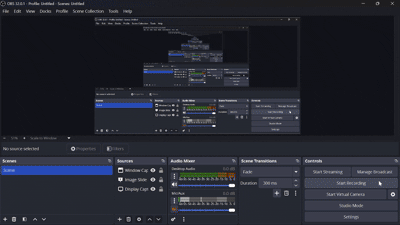

from pathlib import Path

content = r'''# Ubuntu Terminal Boot (UTB) 1.1.0

A terminal boot-style launcher for **Ubuntu on WSL2**.

> UTB is a shell launcher for WSL2. It is not a replacement for the Linux boot process or a secure system login manager.

## 🎬 Demo



## ✨ Features

- Ubuntu-inspired terminal startup screen.
- Displays recent system journal entries with `journalctl`.
- Detects eligible local user accounts automatically.
- Shows account display names and usernames.
- Opens the selected account using Ubuntu's `su`/PAM authentication.
- Optional automatic launch when an interactive WSL Bash shell starts.
- Commands to enable or disable automatic launch.

## 📥 Download

1. Open this repository's **Releases** page.
2. Open the release for **UTB 1.1.0**.
3. Under **Assets**, download `Boot-animation-for-Ubuntu-Terminal-1.1.0.zip`.
4. Save the ZIP in your Windows **Downloads** folder.

Download the release asset, not GitHub's automatically generated **Source code** archive.

## 🪟 Install on Ubuntu WSL

### 1. Open Ubuntu

Open your Ubuntu distribution from the Windows Start menu.

### 2. Create a Downloads folder in Ubuntu

```bash
mkdir -p ~/Downloads
```

### 3. Find the ZIP in Windows Downloads

This command searches Windows user profiles on the mounted `C:` drive. It does not require you to type your Windows username:

```bash
WIN_ZIP="$(find /mnt/c/Users -mindepth 3 -maxdepth 3 -type f -name 'Boot-animation-for-Ubuntu-Terminal-1.1.0.zip' -print -quit 2>/dev/null)"

if [ -z "$WIN_ZIP" ]; then
    echo "UTB ZIP was not found."
    echo "Download the release ZIP into your Windows Downloads folder, then try again."
else
    echo "Found: $WIN_ZIP"
fi
```

If the ZIP was found, extract it into Ubuntu:

```bash
unzip "$WIN_ZIP" -d ~/Downloads/UTB
```

If Ubuntu says `unzip: command not found`, install it:

```bash
sudo apt update
sudo apt install unzip
```

Then run the `unzip` command again.

### 4. Find the installer

The ZIP may contain a top-level folder. This command finds `install.sh` even if the folder structure has an extra level:

```bash
find ~/Downloads/UTB -type f -name install.sh -print
```

### 5. Run the installer

```bash
INSTALLER="$(find ~/Downloads/UTB -type f -name install.sh -print -quit)"

if [ -z "$INSTALLER" ]; then
    echo "install.sh was not found. Check the extracted ZIP contents."
else
    cd "$(dirname "$INSTALLER")" && bash install.sh
fi
```

When installation finishes, close the Ubuntu terminal window or tab and open Ubuntu again to test automatic launch.

## ⚙️ Manage automatic launch

UTB is installed in:

```text
~/.local/share/ubuntu-terminal-boot
```

Check its status:

```bash
~/.local/share/ubuntu-terminal-boot/manage-autostart.sh status
```

Disable automatic launch (UTB remains installed):

```bash
~/.local/share/ubuntu-terminal-boot/manage-autostart.sh off
```

Enable automatic launch again:

```bash
~/.local/share/ubuntu-terminal-boot/manage-autostart.sh on
```

## 🗑️ Uninstall

Find the uninstaller:

```bash
find ~/Downloads/UTB -type f -name uninstall.sh -print
```

Go to the folder containing `uninstall.sh` and run:

```bash
bash uninstall.sh
```

The uninstaller disables the UTB auto-start hook and removes the installed UTB program files. It does not delete Ubuntu itself or your Ubuntu user accounts.

## 📝 Important notes and limitations

- Auto-start runs when an interactive Bash shell starts in WSL. It is not a BIOS/firmware boot screen and does not replace a Linux display or login manager.
- WSL starts its default Linux user session before UTB runs. UTB is a launcher and account selector, **not a security boundary** that locks Windows or WSL.
- `su` may not ask for a password when the currently logged-in user selects their own account. Authentication behavior follows the system's `su` and PAM configuration.
- UTB displays recent journal entries; it does not show a live recording of the boot process.
- Account display names are read from local account information. If no display name is set, UTB shows the username.
- UTB does not store users' passwords.
- This release may display `cannot set terminal process group` or `no job control` when opening a selected account. These messages indicate a terminal job-control issue in the current launcher. This issue should be fixed before describing the release as production-ready.
- The automatic ZIP search assumes the Windows `C:` drive is mounted at `/mnt/c` and the file is in a standard `C:\Users\<profile>\Downloads` folder. If your Windows drive or Downloads location is different, copy the ZIP into Ubuntu manually and extract it there.

## 🧰 Requirements

- Windows with WSL2 enabled.
- An Ubuntu WSL distribution.
- Bash.
- `su`, `getent`, and `journalctl`.
- `unzip` to extract the release package.

## 📄 License

No license has been specified yet. Unless a license is added to this repository, others do not automatically receive permission to redistribute or modify the project.
'''
path = Path("/mnt/data/README-UTB-1.1.0-Universal.md")
path.write_text(content, encoding="utf-8", newline="\n")
print(f"Created: {path} ({path.stat().st_size:,} bytes)")
